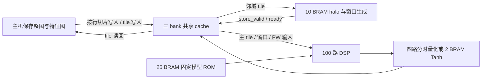

# CycleGAN epoch11 第一轮实现

> 本文资源、时间和测试数字为第一轮历史结果。当前 RTL 的后处理和 DW 流水已优化，最新数字见 [第二轮效率记录](executor_efficiency_iteration2.md)。ISA、固定模型及主机调度范围保持兼容。

目标是 `pe10_10/netG_B_epoch11.pth`、320×240 RGB、7×7 输出层。开始修改前已建立 Git 并提交原始工程，基线为 `820a5df`。参考工程只读。

这一轮完成共享 cache、算子扩展、固定参数 ROM、完整主机层调度以及分层验证。模型使用 checkpoint 的固定 BN 统计转换为 affine NORM，无运行时实例归一化。板级 DDR DMA、自主 FPGA 层控制器和整帧上板验证尚未实现。

## 缓存选择与行写入

采用第三块 cache 同时容纳局部输入和 DW 窗口。物理结构不是三套独立 SDP：前两个逻辑 bank 复用原有 80 个 1024×10 双口 BRAM，第三块新增 40 个 512×20 BRAM，减少前两块的宽写数据选路。计算与主机的缓存访问按核心空闲状态互斥。

| 地址 | 当前调度用途 | BRAM |
|---|---|---:|
| 0～511 | bank0，可供其他工作数据使用 | 与 bank1 共 80 |
| 512～1023 | bank1；512～543 为 DW 临时输出，640 起为算子输出 | 与 bank0 共 80 |
| 1024～1486 | bank2 的 feature 区，1024 起为输入邻域 | bank2 共 40 |
| 1487～1535 | bank2 的 49 个固定 DW 窗口 tile | 使用同一 bank2 |

一次最多加载 3×3 空间邻域、32 个通道，共 288 tile，输入范围 1024～1311；不会与窗口区冲突。残差从当前邻域中心原输入读取。窗口计算完成后随下一条空间指令覆盖，不分配额外窗口 RAM。主机也能使用其他未占用 feature 地址，但当前调度使用固定分区，没有动态分配器。



每个地址的 100 像素仍按 TL/TR/BL/BR 四个 5×5 象限存储。一行 10 个 signed8 像素恰好覆盖四个 20 bit 切片。新增主机掩码为 40 bit，`BusCore.write_row` 只更新该行涉及的 staging word 和四个切片，其他行保持原值。输入首层通过这个接口逐行提交；后续已有 tile 的中间 feature 直接整 tile 装载。

这里已经解决“流式的一行怎样写进 tile 存储”的数据映射，但接口仍要求核心空闲后接受缓存提交。连续摄像头流不能在核心 busy 时无条件写入；板级接入必须提供背压或 DDR 缓冲，并跟踪哪些行已完整、哪些工作区已释放。当前第三块没有直接接摄像头，也没有允许行写入与计算同时竞争同一端口。

原来的 40 个专用窗口 BRAM 已全部删除。保留的 10 个 narrow halo BRAM 为每拍 10 个不同位置的像素读取提供并行副本；共享 cache 的一个宽读端口不能直接给出这些散布位置。继续删除这 10 个副本需串行读取或更宽选路，本轮保留它们以控制 LUT 成本。

## 算子与量化

PW、NORM、DW 沿用原有阵列。新增 CONV 允许普通卷积按输入通道保留原始累加和；新增 ADD 通过同一 DSP 执行两路乘 256 后相加并饱和。普通卷积不能先对每通道 DW 量化再求和。CONV 最多累计 511 个乘法项，7×7×8 输出层使用 392 项；PW 仍限制 256 项。

转置卷积用 1×1、1×2、2×1、2×2 四个真实相位，跨通道完成累加后才做该相位的量化和固定 NORM/ReLU。主机读回四个相位并按奇偶坐标拼接 20×20 输出，再为下一层装载。未用最近邻上采样替代转置卷积，也未增加专用四相缓存 BRAM。

末层直接将 signed32 DSP 原始和送入 Tanh，索引为 `clip((S+8)>>4,-2048,2047)`，得到 uint8 图像字节。不能先将原始和右移 8 并饱和为 signed8。输出缓存保留这 8 bit 字节，主机以 `&255` 恢复 uint8。

为了降低逻辑，量化/激活/池化改为四路量化器和三个比较器，每拍处理一个 2×2 组，共 25 拍。核心 WAIT_POST 期间保持 DSP 输出稳定；不额外复制 100×32 bit 累加向量。代价是每条普通输出指令增加后处理等待。完整固定模型的并行后处理版本为 13655 LUT4/5757 FF；当前为 11515 LUT4/5371 FF。

参数导出保持参考工程的量化顺序：BN 统计和 gamma/beta 先 Q8.8 量化，再形成固定 `[a,b]`。记录到的系数饱和沿用参考定义。checkpoint SHA256 为 `7d6aaac3a6192dddde81602e6120d1aa4dc732690efb8c908cb4757e12dc9a8b`。共有 21603 个参数，ROM 深度补齐到 22016；紧凑 ROM 由 22 个 1024×10 平面、3 个 8192×1 平面和少量例外值逻辑构成。

## ISA v2 与总线差异

沿用 [v1 数据布局及低 90 bit 字段](implementation.md)，新增字段如下。数据、参数高位不得截断。

| 位 | 定义 |
|---|---|
| opcode 3:0 | 新增 4=CONV、5=ADD |
| kernel 43:41 | 新增 5=1×1；原 0～4 不变 |
| 90 | src 的 bit10 |
| 91 | dst 的 bit10 |
| 94:92 | parameter 的 bits14:12 |
| 95 | ring：上/下邻接用显式地址 |
| 106:96 | top：同 x/同 channel 的上方 tile 地址 |
| 117:107 | bottom：同 x/同 channel 的下方 tile 地址 |
| 118 | CONV 原始输出进入 Tanh |
| 127:119 | 保留，必须为零 |

ring=1 时只替换上下邻接基址；左右仍按 tile_pitch 加减，可以表达三行槽回绕。当前主机调度加载完整局部邻域并使用普通 pitch；ring 的三槽回绕单独在 RTL 回归覆盖，尚未实现自主行槽发布控制器。

`keep_acc/more_acc` 对 PW 和 CONV 生效，dst/rounding 必须一致，最后一段才后处理。空间指令先检查所有必需邻接范围，再启动 MAC；错误码 2 的非法续算不会改变未消费的 partial sum。1×1 不请求邻域窗口。

ADD 的 parameter 字段表示第二个缓存输入地址。Tanh 只允许 CONV/FULL 输出，同时禁止 activation/pool/stride2/rounding；Tanh LUT 自己执行其索引舍入。feature 地址合法范围为 0～1486，计算指令禁止访问保留窗口区。

总线仍是同步 32 bit **字地址**接口，握手约定沿用 v1。寄存器变化：

| 字地址 | v2 定义 |
|---|---|
| 1 | cache_address[10:0] |
| 2 | 原四象限掩码；写入时展开到全部 40 个切片 |
| 5 | parameter_address[14:0] |
| 12 | 20 bit 切片写掩码 bits31:0 |
| 13 | 20 bit 切片写掩码 bits39:32 |

无效主机缓存地址 1536～2047 读零、写丢弃，不别名到低 bank；原始主机接口允许写窗口区，因此调度方仍须遵守保留区所有权。参数可写顶层只有 4096 个参数；固定模型顶层 `cyclegan_bus_top` 使用 ROM 并忽略参数写。

## 资源与验证范围

Ti60F225 / C4，`cyclegan_bus_top`，100MHz。以下资源包含总线 staging、全部 feature cache、窗口生成、固定模型 ROM 和 Tanh，不包含摄像头、HDMI 或板级 DDR 接口。

| 部分 | BRAM |
|---|---:|
| 三 bank feature/window cache | 120 |
| halo 副本 | 10 |
| 固定模型 ROM | 25 |
| Tanh | 2 |
| 合计 | **157** |

综合：11515 LUT4、5371 FF、360 ADD、6 SRL8、100 DSP；布局报告为 18638 XLR（含路由占用）、157 memory blocks、100 DSP。100MHz 内部 setup slack +1.969ns，hold slack +0.024ns，分析时钟上限 124.517MHz。这是核心寄存器/存储器之间的时序，尚未约束真实板级总线引脚，不能据此宣称整板或持续输入速率。

验证分为独立层次，不能互相替代：

- 整网整数指令模型：原图、反色图两帧，每帧 16 个阶段与参考工程逐值相等，最终每帧 230400 个 uint8 值一致。模型解码实际 128 bit 指令，但不模拟 RTL 时序、窗口缓存端口或 DDR。
- 固定资产 RTL：全部 22016 个 ROM 字、4096 个 Tanh 索引、极值、舍入平局、停读保持及输出背压通过。
- 真实模型总线样例：DW、PW、固定 BN、CONV/Tanh、ADD 五条指令，包含第三 bank 和高参数地址；RTL 与综合后网表均使用同一外部总线测试。
- 后处理 RTL：205800 像素，包含完整 signed16 输入遍历、三种激活、signed32 极值、部分 tile 池化和复位取消。
- 主机协议模型：70 次按行提交/读回，覆盖七个跨 bank/边界地址和高地址 CONV/Tanh 命令；这是 Python 驱动协议检查，RTL 总线另有测试。
- 通用核心 RTL：109 个用例、160 条指令、44017 拍通过，覆盖原有算子、共享窗口、跨 bank、ring 回绕、ADD 边界输入、普通卷积续算以及非法空间续算恢复。ADD 覆盖 11 个边界左操作数与全部 256 个右操作数，共 2816 对，并非全部 65536 对。具体结果记入 [机器可读验证记录](analysis/cyclegan_iteration1_results.json)。

每帧当前调度为 170880 条计算指令、197400 次行提交、111328 次整 tile 提交、24960 次 tile 读回。完整特征图和四相拼接均由主机内存承担；重复邻域装载的传输成本较高，目前没有给出整网 FPS。后续 DDR/DMA 调度必须减少重复加载，并实现行槽生命周期、背压和层间特征存储；不能直接把当前 Python 调度运行耗时视为 FPGA 速度。

主机接入形式如下。`board_transport` 必须把同步字地址读写转换为实际板级总线握手；它目前不是本工程已提供的对象。

```python
import json
from pathlib import Path
from cyclegan_host import BusCore, GeneratorScheduler

manifest = json.loads(Path('build/cyclegan_model/params_manifest.json').read_text())
engine = GeneratorScheduler(BusCore(board_transport), manifest)
output_chw_u8 = engine.run(rgb_240x320x3)
```

复现命令见 [README](../README.md)。`build/` 中的参考、网表、仿真日志和输出图由脚本生成，不纳入 Git；本记录及机器可读结果保留测试范围和关键资源数据。
