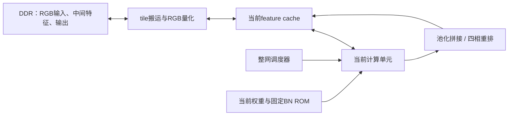

# CycleGAN 部署方案总览（当前工程复核版）

日期：2026-10-09。当前代码：`857e566`。参考工程：`C:/Users/Administrator/Desktop/jisuan/pe10_10`。

> 本文保留最初阅读时的方案快照。后续工程已更新到 `48c80e9`，用户要求四阶段分别完成上板、资源验证和 Git 提交；第一阶段实施与最新结果见 [第一阶段部署记录](cyclegan_stage1_deployment.md)。本文中的历史资源和指令拍数不替代后续实测。

本轮先学习计算单元、核对模型并制定实施方案；未修改生产 RTL、未烧录 FPGA。以下区分已有实现、本轮复核和后续工作。

## 1. 结论与目标

使用当前工程的共享 100 路 DSP 计算单元可以承载参考工程的轻量 CycleGAN 生成器。当前工程已经实现所需的计算指令，后续重点是把主机侧的整网调度、特征存储与拼接搬到板级系统中。

先沿用当前固定 ROM 对应的 `netG_B_epoch11.pth`，输入为 320×240 RGB，末层为 7×7 普通卷积。已直接读取 checkpoint 元数据确认 `model.28.weight` 为 `(3,8,7,7)`，SHA256 为 `7d6aaac3a6192dddde81602e6120d1aa4dc732690efb8c908cb4757e12dc9a8b`。

参考根目录 `cyclegna_mobilenet.py` 仍声明 3×3 输出层，与这份 checkpoint 不一致，不能直接据此实例化目标网络。参考目录还有其他 epoch，后续换权重需重新导出并验证。

部署单方向图像转换只需一个生成器。参考生成器本身采用 BatchNorm；InstanceNorm 出现在判别器中。按本次要求全部使用固定归一化，直接冻结生成器已有的 BN 统计量，不需要设计实例均值、方差、开方或除法电路。

## 2. 当前计算单元的使用方法

### 2.1 从哪个接口接入

- `rtl/cyclegan_bus_top.sv`：固定 epoch11 参数 ROM 的 32 位总线顶层，当前模型优先使用它。
- `rtl/mobilenet_bus_top.sv`：同一总线接口，默认采用可写的 4096×16 参数 RAM；容量不足以一次容纳当前全部 21603 个参数词。
- `rtl/mobilenet_unit.sv`：原生 128 位指令、800 位 tile 及参数接口。自主 FPGA 控制器可直接连接该层，并选择 `MODEL_PARAMS=1`。
- `tools/mn_codec.py`：指令编码、tile 打包与解包，应复用它，避免照历史 ISA 文档手工拼接。
- `tools/cyclegan_host.py`：`BusCore` 负责传输协议，`GeneratorScheduler` 负责逐层调度；`ArrayCore` 是整数指令解释器。

当前 PE 是 100 个空间像素并行，一个周期给所有 PE 广播同一个权重。它不是一次计算 100 个输出通道；每条 PW 指令产生一个输出通道的 10×10 tile。

### 2.2 数据与 cache

特征采用 signed8 Q4.4，权重和固定归一化参数采用 signed16 Q8.8。单个 cache 地址保存一个通道的 10×10 数据，即 800 bit / 100 byte。

tile 按左上、右上、左下、右下四个 5×5 象限排列，每个象限内部按行排列。像素 `(r,c)` 的字节索引为：

```text
p = ((r/5)*2+c/5)*25+(r%5)*5+c%5
```

三个逻辑 bank 共 1536 个地址，当前公开 feature 地址仍限制为 0～1486；1487～1535 保留。最新窗口已经采用独立的八 bank BRAM，不应再依照旧方案把这些尾部地址当作必须使用的窗口存储。

PW 同一空间位置的输入通道必须连续放置。空间卷积的 `tile_pitch` 是相邻空间 tile 的地址步长，`row_pitch` 是局部缓存的 tile 行步长。它们不能直接套用整帧图像的字节跨度。

`edges` 只标记整张特征图的外边界。内部 tile 接缝必须读取真实邻居；把每块 tile 都当作图像边界进行反射会产生接缝。

### 2.3 总线调用顺序

总线采用字地址；若经 AXI 字节地址桥接，需由适配器处理地址转换。事务要保持到 `bus_ready`，读取还必须等 `bus_rvalid`。

1. 复位后读取字地址 0，确认 `memory_ready=1`、`busy=0`；采用现有驱动时还等待 FIFO 为空。
2. 写字地址 1 选择 cache 地址，写 2 选择四象限掩码；整 tile 使用 `0xF`。
3. 向 32～56 写入 25 个 32 位数据字，低字在前；写 3 提交 tile。
4. 向 0 写 `2` 清除旧的 `done_sticky`。
5. 向 8～11 写入指令的四个 32 位字，低字在前；写 7 提交指令。
6. 等待新完成事件，检查状态中的错误码。
7. 写 1 选择输出地址，写 4 发起 cache 读取；等同步返回完成后读取 32～56，解包输出。

逐行装载可通过字地址 12/13 配置 40 位掩码，每位控制 20 bit。它不是字节使能；一行单通道的十个像素需四个 20 位片段。现有 `BusCore.write_row()` 已处理该映射。

原生接口的 `done` 每条指令脉冲一次；总线 `done_sticky` 只表示至少有一条完成，不能单独判断一批 FIFO 指令全部结束。初版继续使用现有单条等待方式。

主机 cache 提交仅在核心空闲时接受。当前即使 BRAM 有独立写端口，也不能直接假设 DMA 与计算可以并行访问。复位不清 cache 内容，每个读取区域必须先装载有效数据。

### 2.4 指令对应关系

| 能力 | 当前用法 | 关键约束 |
|---|---|---|
| DW3×3 | 单通道空间卷积 | 每通道一条，配置局部邻居、边界与填充 |
| PW | 跨输入通道累加 | 每条一个输出通道；一段 1～32 个输入通道 |
| NORM | 固定 `a×x+b` | 参数按 `[a,b]` 存放；可接 ReLU 和 MaxPool |
| ADD | 分支与 skip 相加 | `parameter` 字段在此指令中表示第二个 cache 源 |
| CONV | 单输入通道空间卷积并支持续算 | 用多条指令完成普通卷积或转置卷积某一相位 |
| Tanh | 最后一条 CONV 的末端处理 | 直接使用累加值，不先饱和为 Q4.4 |

普通定点输出为 `sat8((acc+128)>>8)`，其中是否预置 `128` 由 `rounding` 决定。固定归一化为：

```text
a = gamma / sqrt(running_var + eps)
b = beta - running_mean*a
y_raw = sat8((x_raw*a_raw + 16*b_raw + 128) >> 8)
```

为与现有整数参考一致，导出器先把 BN 的 gamma、beta、mean、var 量化为 Q8.8，再计算并量化 a/b。先保持 Conv 后量化、BN 后再量化的顺序；直接融合 BN 会改变中间舍入与饱和结果。

跨输入通道续算时，第一条 `keep_acc=0, more_acc=1`，中间条两者为 1，最后一条 `keep_acc=1, more_acc=0`。同一组必须保持目标地址与 rounding 一致，并连续安排，不能插入其他会清累加器的运算。7×7 的 8 通道输出每个输出通道累加 392 项，低于当前 CONV 的 511 项上限。

末层 Tanh 使用 `clip((acc+8)>>4,-2048,2047)+2048` 作为 LUT 地址，输出为可显示的 uint8。通过 signed8 tile 接口返回后应按 `value & 255` 还原字节，不能继续当作 Q4.4 特征。

## 3. 网络映射总览

尺寸写为 C×H×W，RGB 输入为 3×240×320。

| 阶段 | 保留的算子顺序 | 输出 | 当前单元映射 |
|---|---|---|---|
| 编码 1 | Reflect1 → DW3 → PW → BN → ReLU → Pool2 | 8×120×160 | DW、PW、NORM/ReLU/Pool |
| 编码 2 | Zero1/DW3 → BN → ReLU → PW → BN → Pool2 | 16×60×80 | DW、NORM/ReLU、PW、NORM/Pool |
| 编码 3 | 同编码 2 | 32×30×40 | 同上 |
| 残差 ×9 | Zero1/DW3 → BN → ReLU → PW → BN → Add 输入 | 32×30×40 | DW、NORM/ReLU、PW、NORM、ADD |
| 解码 1 | 转置卷积3,s2,p1,output_padding1 → BN → ReLU | 16×60×80 | 四相 CONV、NORM/ReLU、交错重排 |
| 解码 2 | 同上 | 8×120×160 | 同上 |
| 解码 3 | 同上 | 8×240×320 | 同上 |
| 输出 | Reflect3 → 普通 Conv7,8→3 → Tanh | 3×240×320 | 每输出通道八条 CONV 续算，末条 Tanh |

首层 DW 与 PW 之间没有 BN/ReLU。编码 2/3 的 PW/BN 后没有 ReLU；残差相加后也没有 ReLU。

转置卷积按四个输出奇偶相位拆为 1×1、1×2、2×1、2×2，沿用参考导出器的权重顺序。每个相位跨所有输入通道累加后才舍入饱和，再做 BN/ReLU。四个 10×10 相位交错成 20×20 区域，并输出四个 10×10 tile。

池化则把一个输入 tile 变成 5×5；相邻四个输入 tile 的结果需要写入同一输出 tile 的四个象限。现有主机版通过数组切片完成拼接，硬件版要明确象限地址和完成标记。

## 4. 建议的系统结构与缓存策略



这是目标结构示意。当前代码已有计算单元、cache、ROM 与主机调度；图中的自主控制、DMA 和硬件四相重排尚未接入当前工程。相位重排可读取 cache 中的计算结果，接好写入仲裁后再提交目标 tile，不要求改动 PE 算术。

| 特征 | 整图占用的 10×10 tile | 部署安排 |
|---|---:|---|
| 输入 RGB | 2304 | DDR 保存，局部装载 |
| 编码 1 | 1536 | 超过当前 feature 可用容量，按行/块搬运 |
| 编码 2 | 768 | 可缓存，结合后续输入/输出空间规划 |
| 编码 3及每个残差结果 | 384 | 优先片上驻留，两组区域交替保存输入与输出 |
| 解码 1 | 768 | 先用 DDR 分层验证，再优化驻留 |
| 解码 2 | 1536 | 行缓冲或 DDR |
| 解码 3 | 6144 | DDR，逐行供应输出卷积 |
| 最终 RGB | 2304 | DDR，供回读或 HDMI 显示 |

首版保持现有地址分配：第三逻辑 bank 从 1024 开始放局部 3×3 邻域，最多 `9×32=288` 个输入 tile；512 开始放 DW 中间结果；640 开始放 PW/最终结果。整图保存在主机内存或 DDR 中，便于逐层核对。

通过后再实施固定分区与行槽生命周期管理：残差保存完整 384 tile 输入及 384 tile 输出；编码 2/3 的三行输入分别需 384 tile；输出 7×7 卷积的三行 8 通道输入需 768 tile。当前 ISA 的 `ring/top/bottom` 已能指定上下行槽，后续调度器可复用，但现有 `GeneratorScheduler` 仍逐块重载邻域。

参考工程的 DDR tile 为 128 byte，其中前 100 byte 是相同象限打包的数据，后 28 byte 为填充。可复用这种外存布局；参考工程 cache 含镜像区和不同逻辑地址映射，不能把其旧地址常量直接搬入当前 cache。

## 5. 分阶段实施与验收（按后续用户要求更新）

| 阶段 | 主要工作 | 验收结果 |
|---|---|---|
| 1：输入到残差前 | 三层编码、固定 BN、池化、片上连续发指令和 DDR 预取 | 32×30×40；上板、资源/时序验证、独立 Git 提交 |
| 2：残差模块 | 九个残差块，双区驻留，完成 ADD 后释放 skip | 逐块及最终结果；上板、资源/时序验证、独立 Git 提交 |
| 3：转置卷积 | 三层转置卷积、四相重排、逐行搬运 | 8×240×320；上板、资源/时序验证、独立 Git 提交 |
| 4：7×7 输出 | 八输入通道续算、输出量化与 Tanh | 3×240×320；上板、资源/时序验证、独立 Git 提交 |

新增模块可以按职责命名为 `cyclegan_controller`、`cyclegan_tile_dma`、`cyclegan_phase_pack` 和 `cyclegan_board_top`；这是拟议划分，并非当前已有文件。优先调用现有计算指令，不复制第二套 PE 阵列。

各阶段从实现时就考虑连续供指令及搬运重叠；并发访问必须按 cache 槽所有权管理，验证不会覆盖仍在使用的输入、skip 或相位结果。第一阶段的实际实现及验收见 [阶段记录](cyclegan_stage1_deployment.md)。

## 6. 本轮验证与资源依据

本轮重新运行：

- 主机协议检查通过：70 次行提交/回读，覆盖 7 个 cache 地址及扩展 CONV/Tanh 指令。
- 使用当前源码重新编译 RTL，真实 epoch11 参数的总线冒烟通过：6 条指令、1006 个测试周期，覆盖 DW、PW、固定 BN、ADD、7×7 CONV/Tanh、第三 bank 和扩展参数地址。
- 一帧整网整数指令调度通过：16 个阶段全部与独立整数参考一致，最终检查 230400 个输出值。这项运行使用 `ArrayCore`，不是整帧 RTL 或板上验证。
- 当前 17 个 RTL/ROM/LUT 文件 hash 与第八轮资源记录匹配，checkpoint hash 也匹配。

本轮日志：`build/sim/deployment_review_bus.log`、`build/deployment_review_schedule.log`。逐层结果记录：`build/cyclegan_schedule/validation.json`。

已有第八轮综合记录为 100 DSP、195 BRAM、14857 LUT4、4040 FF；100 MHz 内部时钟的 setup/hold slack 分别为 1.809/0.026 ns。该记录不含后续新增 DDR/摄像头/HDMI/自主控制器，板级 I/O 尚未约束；本轮没有重新综合或布局布线。

当前无舍入 PW 为 `Cin+8` 拍；无补边普通 3×3/7×7 空间指令为 77/117 拍。实际网络还包含舍入、补边、续算、Tanh、搬运及等待，不能把上述指令周期直接换算成整网帧率，也不能沿用参考工程的历史帧率。

主机基线每帧执行 170880 条计算指令，另有 111328 次整 tile 写、197400 次行写和 24960 次 tile 读。大量重复搬运说明行缓冲和驻留优化有明确价值；初版接口主要用于验证。

上述验证为首次阅读时的基线。后续按第四节的驻留/行槽思路实现片上自主调度，进度以新的四阶段记录为准；固定归一化复用已有 NORM 指令。

## 7. 主要阅读依据

当前工程：

- `rtl/mobilenet_unit.sv`、`rtl/mobilenet_bus_top.sv`、`rtl/cyclegan_bus_top.sv`
- `rtl/mn_pe_array.sv`、`rtl/mn_cache.sv`、`rtl/mn_dw_buffer_bram.sv`、`rtl/mn_postprocess.sv`
- `tools/mn_codec.py`、`tools/cyclegan_host.py`、`tools/prepare_cyclegan_assets.py`
- `sim/tb_cyclegan_bus.sv`、`sim/check_host_protocol.py`
- `docs/window_bram_iteration8.md`、`docs/analysis/cyclegan_iteration8_results.json`

参考工程：

- `cyclegna_mobilenet.py`、`netG_B_epoch11.pth`
- `tools/inspect_pth.py`、`tools/prepare_generator_params.py`、`tools/export_first_layer.py`
- `generator/rtl/generator_compute_array.v`、`generator/rtl/phase_interleave_bram.v`
- `generator/CACHE_DATAFLOW_CN.md`、`generator/README.md`、`camera/EPOCH11_7X7.md`

历史可行性文档中的 180 BRAM 目标、167/150 BRAM 估算及旧窗口实现不作为本次新要求或当前实测结果；后续以实际新增模块后的综合报告确定整机资源。
