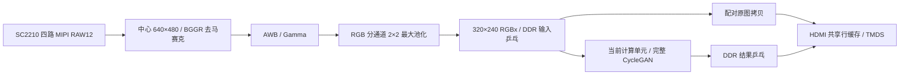

# SC2210 实时输入、ISP、CycleGAN 与 HDMI

本工程增加独立顶层 `rtl/video/cyclegan_camera_board.sv`，使用现有计算单元运行完整生成器。摄像头、ISP 和显示接口来自只读参考工程 `C:/Users/Administrator/Desktop/jisuan/pe10_10`；网络仍是 `ac1fbbc` 已验证的 Q4.4 激活、Q8.8 参数、固定归一化版本。计算 RTL 的 22 个文件散列与第四阶段一致。

## 数据链路



- 沿用参考工程 SC2210 的 265 项 I2C 配置、四通道位序/极性、下降沿采样和板级引脚。RAW12 取高 8 位，裁剪 x=640…1279、y=300…779，使用三行 RAW halo 做 BGGR 双线性插值。
- ISP 使用过滤暗像素及近饱和像素的灰世界 AWB，三个通道共享一个统计除法器；增益限制为 0.5～3，按 1/4 权重平滑，在下一帧 SOF 生效。Gamma 表及来源保存在 `rtl/video/camera_gamma.mem`、`gamma_provenance.json`。ISP 的 AWB 与网络的固定归一化各自独立。
- 网络输入为 320×240 RGB，三层编码、九个残差块、三层转置卷积、7×7 输出及 Tanh 均复用当前计算单元。
- HDMI 为 1280×720、约 60 Hz；原图和结果均放大两倍显示为 640×480，周围补黑。两种模式共用六块行 RAM 和一个读取执行器。`key_data[0]` 低电平按下，10 ms 消抖，每次按下切换一次；上电默认显示结果。

## 帧所有权与 DDR

| DDR 基址 | 数据 |
| --- | --- |
| `0x000000 / 0x100000` | RGBx 输入，两槽各 307,200 字节 |
| `0x300000` | 第一层转置卷积特征 |
| `0x400000` | 第二层转置卷积特征 |
| `0x500000` | 第三层转置卷积特征 |
| `0x600000 / 0x700000` | 网络结果，两槽各 2304×128 字节 |
| `0x800000 / 0x900000` | 与结果配对的 RGBx 原图 |

采集槽使用 FREE → WRITING → READY → READING → FREE，最后一个 DDR B 响应后才发布。无可用槽时丢弃整帧。原图拷贝完成后启动网络，结果最后一个写响应完成后发布；显示只在垂直帧边界交换槽，确认后才复用旧槽，防止撕裂和原图/结果错配。

DDR 仲裁按完整 burst 保持所有权；采集 FIFO 有完整待写块时优先服务，显示行缓存余量不足时优先补行，其余时隙公平服务计算和拷贝。原图拷贝先收齐一个读取 burst 再发写地址，避免未填充写事务阻塞显示读取。

当前网络每个 tile 是 `50 有效 + 14 零 + 50 有效 + 14 零`，不同于参考显示模块的连续 100 字节。HDMI 已针对这个格式重接固定字节连线：跨第 4/5 行的成对读取需要五拍，第 8/9 行需要四拍。两行余量时优先补充显示缓存，三行就绪后允许计算公平竞争；压力测试覆盖此边界。

## 验证结果

资源与布局布线已通过，计算时钟 150 MHz 的 setup/hold 余量为 **0.700 / 0.035 ns**，全部已分析时序关系非负。

| 资源 | 第四阶段静态输入 | 实时视频 | 增量 |
| --- | ---: | ---: | ---: |
| LUT4 | 22,804 | 26,245 | +3,441 |
| FF | 12,323 | 12,985 | +662 |
| RAM10 + DPRAM10 | 222 | 249 / 256 | +27 |
| DSP48 | 100 | 103 | +3 |

新增 DSP 用于 ISP RGB 增益，计算阵列仍为原有 100 个 DSP。整帧数据放在 DDR，BRAM 只保存行数据、FIFO 和短 burst 缓冲。

仿真覆盖真实 RAW 裁剪/ISP/池化链路的 76,800 个精确 RGB 像素、640×480 高亮统计范围、帧标签、溢出/中断恢复及按键消抖。HDMI 压力测试检查 **1,228,800 个放大像素、11,059,200 个 TMDS 数值**，竞争读取及背压下无欠载，并正确定位主动注入的坏读。

板级协议仿真使用明确标识的网络协议模型，逐字检查两张输入并输出黄金 half tile，验证真实采集/拷贝/CDC/写回/DDR 仲裁/显示模块的两槽交替、460,800 个输出字节、整帧丢弃及 VSYNC 确认。协议模型仅存在于 `sim/video`，不进入综合。网络算术的本轮验证采用真实摄像头同帧回读，计算 RTL 散列同时与已通过原生整网仿真的第四阶段核对。

真实摄像头同帧的 **230,400 个输出 RGB 字节零差异**。回读的配对原图与实际计算输入 CRC 一致；从原始 epoch11 checkpoint 重新生成的直接 scatter 整数参考、编码指令模型的全部 16 个输出张量及 FPGA 结果均一致。原图 HDMI 像素校验和为 45,235,656，结果为 62,561,680，分别与 DDR 回读数据按两倍显示计算的校验和一致。

两种显示模式各等待 60 秒并采样状态，观测窗口合计完成 **2,137 帧**，溢出、裁剪过载、HDMI 欠载、原图校验错误均为 0；两种模式均持续运行完整网络。

| 显示模式 | 摄像头 FPS | 网络完成 FPS | 窗口内完成帧数 | 暂停后稳定计算样本 | 原图拷贝样本 | 指令等待周期 |
| --- | ---: | ---: | ---: | ---: | ---: | ---: |
| 网络结果 | 60.04 | 15.04 | 916 | 48.670 ms | 2.261 ms | 0 |
| 原图 | 59.96 | 20.03 | 1,221 | 46.879 ms | 1.713 ms | 0 |

计算样本不包含采集、排队及 HDMI 帧边界发布等待。网络结果的 tiled 显示读取与计算共享 DDR，当前结果显示模式约 15 fps；原图模式约 20 fps。摄像头约 60 fps，没有可用输入槽时丢弃整帧，属于预期调度行为。验证结束已恢复实体按键控制。

用户于 2026-10-10 确认 HDMI 动态画面和实体按键切换均正常。本轮数值比较仍以当前定点、固定归一化模型为基准。

## 复现

连接同参考工程的 SC2210、HDMI 显示器、JTAG，保持板卡供电。在本工程目录执行：

```powershell
# 六项视频单元仿真及板级协议仿真
./scripts/run_video_modelsim.ps1
./scripts/run_video_modelsim.ps1 -Tests board

# 构建、检查资源/时序、JTAG SRAM 烧录
./scripts/run_video_board.ps1 -Program
# 已有本轮构建可跳过构建，仍检查源码散列与全部 flow/timing/resource 门槛
./scripts/run_video_board.ps1 -ReuseBuild -Program

# 同帧回读、独立参考、两种显示模式各 60 秒测试及验证记录
./scripts/verify_video_board.ps1
```

`verify_video_board.ps1` 的 `live_pair` 目录要求尚不存在，防止覆盖旧的同帧证据；复用已经采集的同帧可指定 `-ReuseCapture`。结束时恢复实体按键控制。数值参考使用本机原始 epoch11 checkpoint；生成器参数准备沿用第四阶段资产流程。

Efinity 项目在 ASCII 临时目录中生成，其路径保存在 `build/video_verified/staging_path.txt`。`outflow/encoder_board.bit` 为实时视频码流；验证脚本检查当前 RTL/板级模板散列、Ti60 器件 ID、烧录成功、所有 flow PASS 及 routed timing。SRAM 配置断电后需要重新烧录。

输入及输出图像位于 `build/video_verified/live_pair/camera_original.png`、`fpga_styled.png`，参考为 `instruction_reference.png`。完整机器可检查证据见 [板级验证记录](analysis/cyclegan_video_deployment.json)。视频接口原始来源散列见 `board/video/reference_imports.json`。
